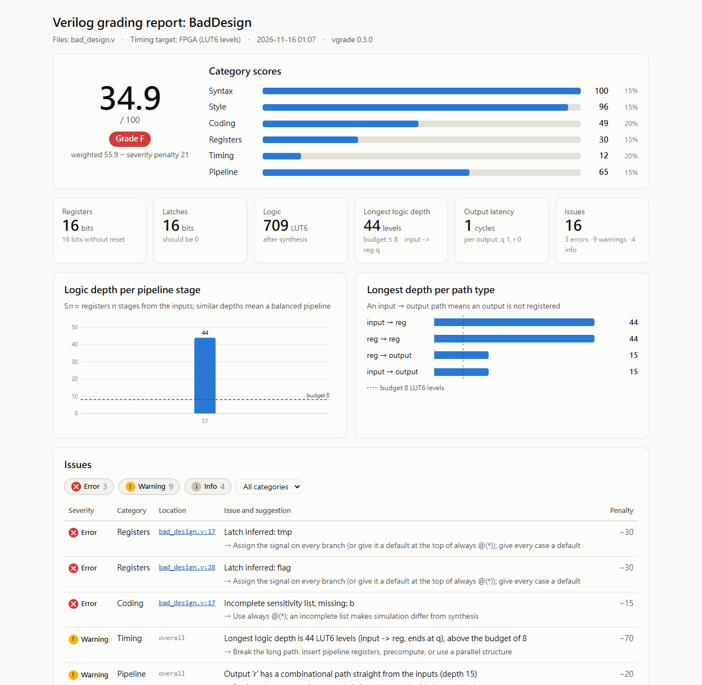
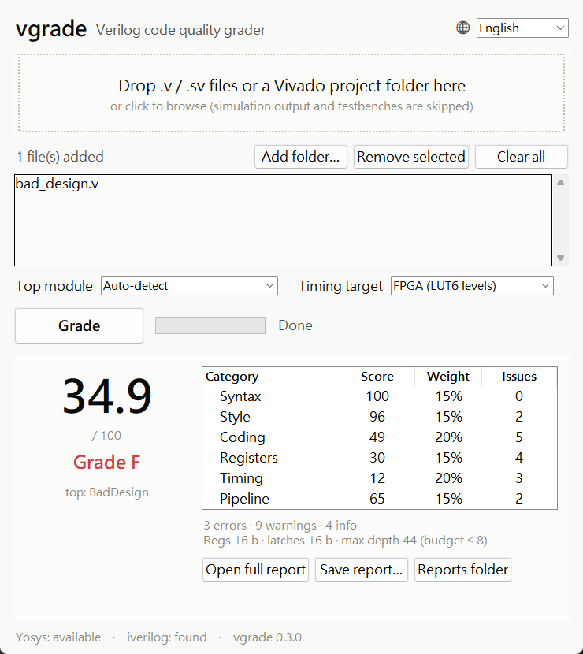

# vgrade — Verilog code quality grader

[繁體中文](README.md) | **English**

> Grades a Verilog design the way a senior engineer reviews it — not just "does it work", but **syntax, style,
> coding practice, register usage, timing and pipeline structure** — and tells you where each problem is and how to fix it.



## Desktop app (Windows, no Python needed)

Download `vgrade-win64.zip` from [Releases](https://github.com/WANG-JUI-CHAO/vgrade/releases), unzip it and run `vgrade.exe`.



1. Drop `.v` / `.sv` files — or a **whole Vivado project folder** — onto the window (simulation output and testbenches are skipped)
2. Optionally pick the top module and the timing target (FPGA / ASIC)
3. Click **Grade**; the HTML report opens automatically (copies are kept in `%LOCALAPPDATA%\vgrade\reports`)

Use the 🌐 menu in the top-right corner to switch between **繁體中文 and English**. The current result and report are
re-rendered in the new language without grading again, and the choice is remembered.

Yosys is bundled. The first run compiles it (30 s – 1 min); after that grading takes a few seconds. If Icarus
Verilog is installed it is used for syntax checking.

## Command line

```bash
pip install yowasp-yosys
python vgrade.py design.v --lang en
python vgrade.py top.v fifo.v --top top --target asic --lang en
python vgrade.py design.v --lang en --html report.html --open
python vgrade.py design.v --lang en --json report.json
```

Without `--lang` the language follows the system locale (or the `VGRADE_LANG` environment variable).
JSON reports contain the localized `message`/`suggestion` plus a language-neutral `key` and `params` for tooling.

## What is graded

| Category | Weight | Checks |
|---|---|---|
| **Syntax** | 15% | Compile errors and warnings (Icarus Verilog `-Wall`) |
| **Style** | 15% | Mixed tabs/spaces, indentation, line length, trailing whitespace, several statements per line, snake_case names, UPPER_CASE parameters, `_n` on active-low signals, comment density, ANSI ports |
| **Coding** | 20% | Blocking assignments in sequential logic, non-blocking in combinational logic, incomplete sensitivity lists, multiple drivers, case without default, casex, gated clocks, `#` delays and `initial` in RTL, combinational loops, undriven signals |
| **Registers** | 15% | Inferred latches, registers removed by synthesis (unused / constant / duplicate), control registers without reset |
| **Timing** | 20% | Longest logic depth (LUT6 or gate levels), hardware divide/modulo, wide multipliers, long priority chains |
| **Pipeline** | 15% | Stage depth balance, input-to-output combinational paths, unregistered outputs, over-deep stages |

```
Score = weighted category average − severity penalty (−4 per error, −1 per warning, at most 30)
```

Grades: A ≥ 90, B ≥ 80, C ≥ 70, D ≥ 60. **Any error-level issue caps the grade at C.**

Timing and pipeline figures come from a graph analysis of the Yosys netlist (logic levels between registers,
register stages from the inputs, per-output latency). They are technology-independent estimates; FPGA adders use
carry chains, so wide adders are over-estimated.

## Building the app

```bash
pip install pyinstaller tkinterdnd2 yowasp-yosys
python build_exe.py        # dist/vgrade/vgrade.exe and dist/vgrade-win64.zip
```

## Tests

```bash
python -m unittest discover -s tests -v
```

## Adding a language

All user-facing text lives in [`i18n.py`](i18n.py). Add a language code to `LANGS`/`LANG_NAMES` and a
translation to each entry; `tests/test_vgrade.py` checks that every entry is translated and that the
placeholders match.

## License

MIT
