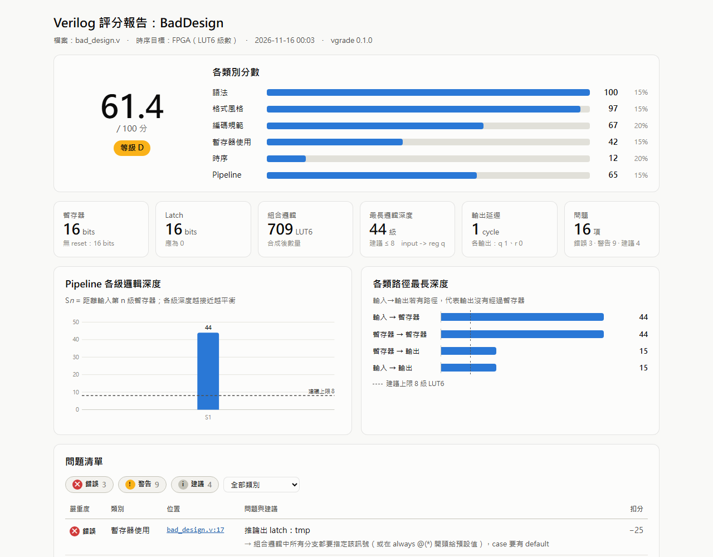

# vgrade — Verilog 程式碼品質評分工具

> 不只看「功能對不對」，而是像資深工程師 code review 一樣，從 **語法、格式、編碼規範、暫存器使用、時序、pipeline** 六個面向替 Verilog 設計打分，並告訴你每個問題在哪一行、該怎麼改。

```
==================================================================
 vgrade 0.1.0 評分報告   top: BadDesign   檔案: bad_design.v
==================================================================
 總分  61.0 / 100   等級 D

 類別          分數    權重
 語法          100     15%   ####################
 格式風格      97      15%   ###################
 編碼規範      65      20%   #############
 暫存器使用    42      15%   ########
 時序          12      20%   ##
 Pipeline      65      15%   #############
------------------------------------------------------------------
 設計統計（目標：FPGA LUT6）
   暫存器        : 16 bits（無 reset 16 bits）
   Latch         : 16 bits
   最長邏輯深度  : 44 級（input -> reg，終點 q；建議 <= 8）
   ...
------------------------------------------------------------------
 [錯誤][暫存器使用] bad_design.v:17  推論出 latch：tmp (-25)
        -> 組合邏輯中所有分支都要指定該訊號（或在 always @(*) 開頭給預設值）
 [錯誤][編碼規範] bad_design.v:17  敏感列表不完整，缺少：b (-10)
        -> 改用 always @(*)；不完整的敏感列表會造成模擬與合成結果不同
 [警告][時序] bad_design.v:24  硬體 div 運算（16 bits） (-15)
 ...
```

### HTML 評分報告

加上 `--html report.html` 會另外產生一份**單一檔案、離線可用**的評分報告，可以直接傳給同學、助教，或列印成 PDF：



- 總分、等級與六個類別的分數長條
- 設計統計：暫存器、latch、邏輯數量、最長深度、輸出延遲
- Pipeline 各級深度圖與各類路徑深度圖（含建議上限線，滑鼠移上去可看數值）
- 可依嚴重度、類別篩選的問題清單，點位置直接跳到原始碼
- 原始碼標註：有問題的行標色，說明就寫在該行下方
- 支援深色模式與手機瀏覽

## 評分項目

| 類別 | 權重 | 檢查內容 | 方法 |
|---|---|---|---|
| **語法** | 15% | 編譯錯誤、警告（隱含 net、位寬不符、timescale） | Icarus Verilog `-Wall` |
| **格式風格** | 15% | tab/空白混用、縮排、行長、行尾空白、一行多敘述、snake_case 命名、參數大寫、active-low `_n`、註解比例、ANSI port | 原始碼分析 |
| **編碼規範** | 20% | 循序邏輯用 blocking、組合邏輯用 non-blocking、敏感列表不完整、多重驅動、case 缺 default、casex、gated clock、RTL 中的 `#` 延遲與 `initial`、組合邏輯迴圈、undriven 訊號 | 原始碼分析 + Yosys `check` |
| **暫存器使用** | 15% | latch 推論、被合成移除的無用/常數/重複暫存器、控制暫存器缺 reset | Yosys 合成比對 |
| **時序** | 20% | 最長邏輯深度（LUT6 或邏輯閘級數）、硬體除法/取餘、寬乘法器、長 if-else 優先權鏈 | 合成後 netlist 圖分析 |
| **Pipeline** | 15% | 各級邏輯深度平衡度、輸入直達輸出的組合路徑、未暫存的輸出、單級過深 | netlist 暫存器級數分析 |

不適用的類別（例如純組合電路沒有 pipeline）會標成 N/A，權重自動重新分配。

### 時序與 pipeline 怎麼算？

1. 用 Yosys 合成並 flatten，映射到 **LUT6**（`--target fpga`，預設）或**通用邏輯閘**（`--target asic`）
2. 把 netlist 建成有向圖，以暫存器為邊界，計算每條 `input→reg`、`reg→reg`、`reg→output`、`input→output` 路徑的邏輯級數
3. 用 0-1 最短路徑算出每個暫存器距離輸入幾級（pipeline stage），統計每一級的最大深度 → 判斷是否平衡
4. 同時得到每個輸出的 latency（幾個 cycle）

> 邏輯級數是**與製程無關的估計值**，適合比較設計好壞。FPGA 的加法器實際會用 carry chain，所以寬加法器的級數會被高估。

## 安裝

需要 Python 3.10+。

```bash
pip install yowasp-yosys          # Yosys 合成器（純 pip 安裝，Windows/Mac/Linux 都可）
```

建議另外安裝 [Icarus Verilog](https://bleyer.org/icarus/) 做語法檢查。兩者都沒有時仍可執行格式與編碼規範檢查。

## 使用

```bash
python vgrade.py design.v                        # 單一檔案
python vgrade.py top.v fifo.v ctrl.v --top top   # 多檔案專案
python vgrade.py design.v --target asic          # 以 ASIC 邏輯閘級數評估時序
python vgrade.py design.v --max-levels 6         # 自訂邏輯深度上限
python vgrade.py design.v --no-info              # 只顯示錯誤與警告
python vgrade.py design.v --json report.json     # 輸出 JSON（方便批次改作業、做統計）
python vgrade.py design.v --html report.html --open   # 產生 HTML 評分報告並用瀏覽器開啟
```

testbench module（名稱以 `tb`/`test` 開頭、`_tb` 結尾，或無 port 且有 `initial`）會自動略過。

## 範例

| 檔案 | 說明 | 分數 |
|---|---|---|
| [`examples/good_mac.v`](examples/good_mac.v) | 3 級 pipeline 乘加器，暫存器輸出、各級平衡 | A |
| [`examples/bad_design.v`](examples/bad_design.v) | 故意包含 latch、gated clock、除法器、敏感列表不完整… | D |

## 測試

```bash
python -m unittest discover -s tests -v
```

## 限制

- 原始碼檢查以正規表示式為主，不是完整的 Verilog parser；`` `define `` 巨集、`generate` 內的複雜結構可能誤判
- 評分權重與門檻是依常見 coding guideline 設定的經驗值，可依課程需求調整 `CATEGORIES` 與各規則扣分

## Roadmap

- [x] HTML 評分報告
- [ ] 在報告中畫出關鍵路徑經過的訊號
- [ ] 批次模式：一次評整個資料夾、輸出成績 CSV
- [ ] 設定檔（自訂權重、關閉規則）
- [ ] 整合 [verilog-tbgen](https://github.com/WANG-JUI-CHAO/verilog-tbgen)，加入功能正確性分數
- [ ] AI 文字回饋：針對每個問題給出修改範例

## License

MIT
